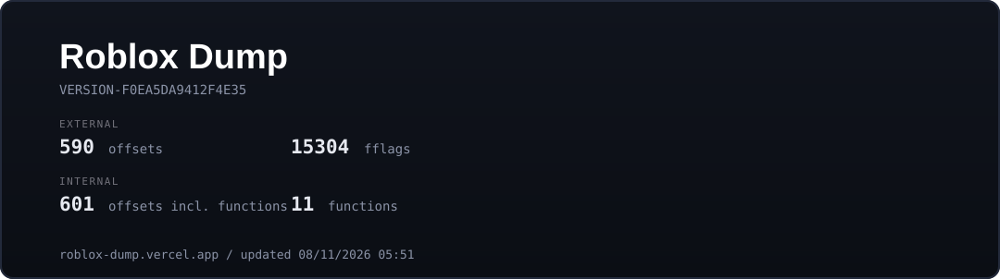

<p align="center">
  
</p>

<p align="center">
  <a href="https://roblox-dump.vercel.app">roblox-dump.vercel.app</a><br>
  <sub>Last updated 08/11/2026 04:54</sub>
</p>

## Output

```text
external/                       <- RPM usage (base + offset)
  offsets/   Offsets.hpp / .cs / .json / OffsetsHex.json / .txt
  fflags/    FFlags.hpp / .cs / .json / FFlagsHex.json / .txt
internal/                       <- injected usage (same offsets + callables)
  offsets/   Offsets.hpp / .cs / .json / OffsetsHex.json / .txt
  fflags/    FFlags.hpp / .cs / .json / FFlagsHex.json / .txt
  functions/ Functions.hpp / .cs / .json   (call RVAs: fire, remote events, task...)
misc/
  Struct.hpp
  Types.json
  report.txt
```

The same files are generated to `dump/version-f0ea5da9412f4e35/` on every run.

## Repository layout

```text
roblox-dumper/
  external/         offsets + fflags (all formats)
  internal/         offsets + fflags (all formats)
  misc/             Struct.hpp / Types.json / report
  docs/             banner
```
